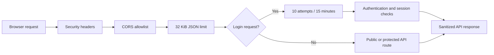

# ND3 - Security, SEO, and Performance Evaluation

Owner: Son Van Phat (2212535)

Scope: FitKitchen backend API and customer/admin frontend

Evaluation date: 2026-11-21

## Outcome

The implementation adds enforceable API hardening and corrects indexation rules for private frontend routes. Backend unit tests pass. A production frontend build and Lighthouse run remain environment-dependent because Bun is not installed on the verification machine.



## Security

### Implemented controls

- Removes the Express `X-Powered-By` fingerprint.
- Adds CSP, clickjacking, MIME-sniffing, referrer, browser-feature, and opener isolation headers to API responses.
- Limits JSON request bodies to 32 KiB to reduce oversized-payload abuse.
- Limits `POST /api/auth/login` to 10 attempts per IP in a rolling 15-minute window and returns `429`, `Retry-After`, and rate-limit metadata after the limit.
- Keeps the existing JWT algorithm, issuer, audience, expiry, database session, role, account-lock, and ownership validation unchanged.

### Dependency audit

`npm audit` reported no critical or high-severity vulnerabilities. It reported two moderate development-only findings in the `nodemon -> minimatch` chain. The registry's proposed resolution is a nodemon downgrade, so no automatic or forced dependency change was applied. Reassess when a compatible patched nodemon release is available.

### Verification

- `npm test` in `backend`: 19 passed, 0 failed.
- `node --check` on the changed backend JavaScript: passed.
- `git diff --check`: passed.

## SEO

- Public storefront and meal pages retain descriptive titles and meta descriptions.
- `/login`, `/admin`, and `/dashboard` now emit `noindex, nofollow, noarchive`; these account-specific pages should not appear in search results.
- Removed template-specific author and social-account metadata that incorrectly attributed the site to Lovable.
- `robots.txt` continues to allow public content. A sitemap was not added because the repository does not define a canonical production origin; publishing a guessed sitemap URL would be misleading.

## Performance

### Existing positive findings

- The home hero declares intrinsic dimensions and `fetchPriority="high"`, reducing layout shift and prioritizing the likely LCP image.
- Menu images support native lazy loading.
- Menu search is debounced and network requests receive an abort signal.
- Infinite menu pagination bounds each fetch instead of loading the full catalog at once.
- Font origins are preconnected.

### Measurement procedure

After Bun is available, run:

```bash
cd frontend
bun install --frozen-lockfile
bun run test
bun run lint
bunx --no-install tsc --noEmit
bun run build
bun run preview
```

Then run Lighthouse against the preview URL in mobile and desktop modes. Record Performance, Accessibility, Best Practices, and SEO scores plus LCP, CLS, INP/TBT, and total transferred bytes. Test the home page, a meal detail page, and the login page. Use a production build; development-server scores are not valid evidence.

## Remaining risks and follow-up

- The login limiter is process-local. A multi-instance deployment should move counters to a shared store or edge gateway.
- A strict CSP for the rendered frontend should be configured at the hosting layer after confirming all required image, font, API, and Shopify origins. The CSP added here protects JSON API responses and does not claim to cover the separately hosted frontend.
- Run the frontend test/build/Lighthouse procedure on a machine with Bun before final submission and attach the exported Lighthouse reports outside the repository.
